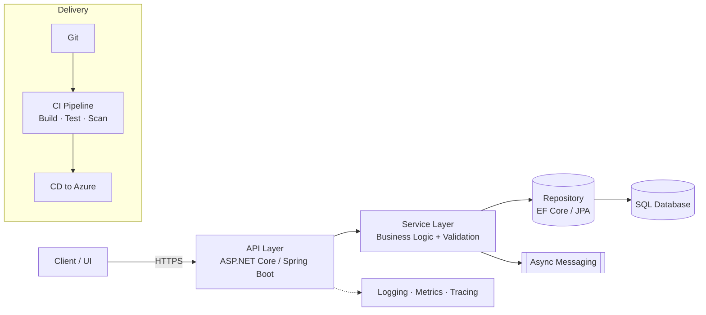

<div align="center">


<p>
  <a href="mailto:mail.ayushkumar2002@gmail.com"></a>
  <a href="https://www.linkedin.com/in/YOUR-LINKEDIN-ID"></a>
  <a href="YOUR-PORTFOLIO-URL"></a>
  
</p>

</div>

---

## `~/about`

```csharp
public sealed record Engineer
{
    public string Name        => "Ayush Kumar";
    public string Role        => "Specialist Programmer @ Infosys (Hyderabad, IN)";
    public string Domain      => "Data governance & compliance — Microsoft Purview";
    public string[] Core      => ["C#", "Java", "Python", "TypeScript", "SQL"];
    public string[] Backend   => ["ASP.NET Core", "Entity Framework", "Spring Boot", "REST APIs", "Microservices"];
    public string[] Cloud     => ["Azure", "CI/CD", "Git"];
    public string[] AI        => ["GitHub Copilot", "Claude Code", "Cursor", "Semantic Kernel", "Agentic AI"];
    public string Education   => "B.Tech CSE (CGPA 8.49/10)";
    public string Philosophy  => "Clean contracts, testable services, observable systems.";
    public string OpenTo      => "Backend / Cloud / AI-integrated engineering roles";
}
```

---

## `~/experience`

| Role | Org | Period | Focus |
|---|---|---|---|
| **Specialist Programmer** | Infosys, Hyderabad | Aug 2025 – Present | Building and maintaining backend services for **Microsoft Purview** (data governance & compliance) using ASP.NET Core, Entity Framework, Azure, REST APIs and CI/CD pipelines |
| **Software Development Intern** | Equifax, Pune | Feb 2025 – Jun 2025 | Developed **Java / Spring Boot microservices**; optimized SQL queries for performance |

---

## `~/tech-stack`

<div align="center">

**Languages**


**Backend & Cloud**


**Frontend & Testing**


</div>

---

## `~/architecture-mindset`

How I approach a typical service:



**Engineering principles**

- **Separation of concerns** — thin controllers, domain logic in services, persistence behind repositories
- **Test early** — unit tests (JUnit / xUnit) around business logic, integration tests around contracts
- **Performance-aware** — query plans, indexing and N+1 avoidance before premature caching
- **Automate delivery** — every merge goes through a CI/CD pipeline
- **Observability by default** — structured logs and traceable requests

---

## `~/ai-assisted-engineering`

I treat AI tools as force multipliers, not replacements for engineering judgment.

- **Tooling:** GitHub Copilot · Claude Code · Cursor — for scaffolding, refactoring, test generation and code review assistance
- **Agentic AI:** studied agent design patterns (planning, tool use, memory) and orchestration with **Microsoft Semantic Kernel**
- **Practice:** AI drafts → I review, test and own every line that ships

---

## `~/featured-projects`

> Replace the placeholders below with your pinned repositories and real links.

| Project | Stack | Highlights |
|---|---|---|
| 🎬 **[Full-Stack Video Streaming Platform](https://github.com/whoayushh/REPO-NAME)** | MERN, REST APIs | Auth, video upload & playback, responsive UI |
| 🔧 **[Project Name](https://github.com/whoayushh/REPO-NAME)** | Spring Boot, SQL | One line on the problem and your solution |
| ☁️ **[Project Name](https://github.com/whoayushh/REPO-NAME)** | ASP.NET Core, Azure | One line on the problem and your solution |

---

## `~/github-stats`

<div align="center">


</div>

---

## `~/currently`

- 🔭 Deepening expertise in **cloud-native backend systems** on Azure
- 🤖 Building with **Semantic Kernel** and agentic AI workflows
- 🌱 Exploring system design, distributed systems and observability
- 💬 Ask me about: **ASP.NET Core · Spring Boot · MERN · Azure · AI-assisted development**
- 📫 Reach me: [mail.ayushkumar2002@gmail.com](mailto:mail.ayushkumar2002@gmail.com)

<div align="center">


</div>
